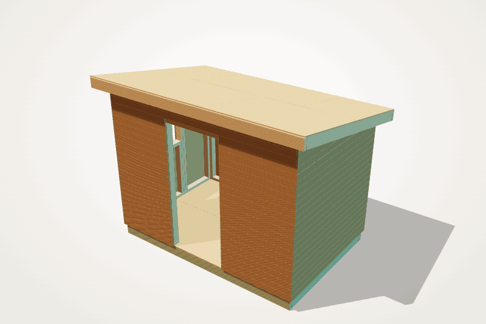
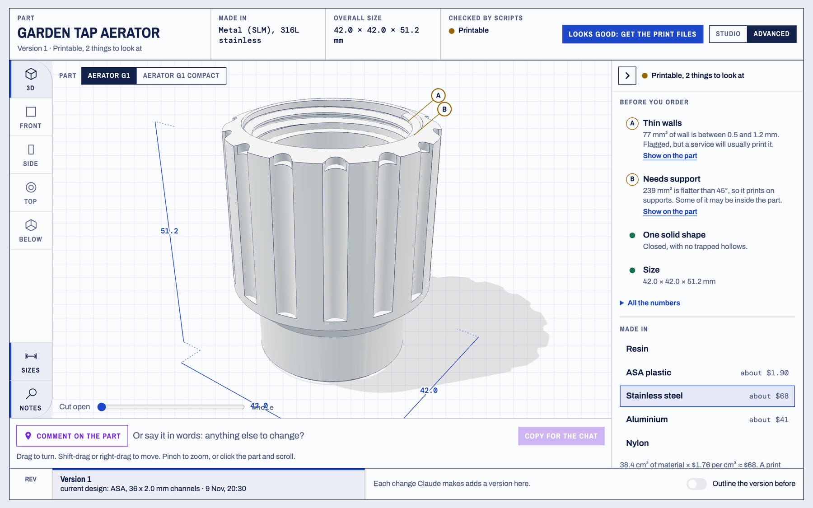
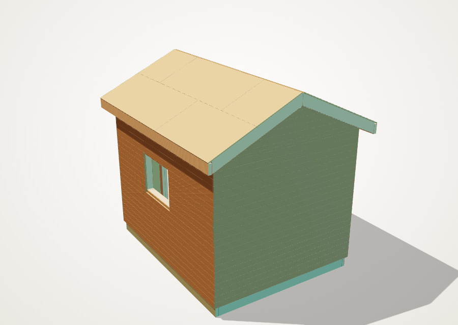
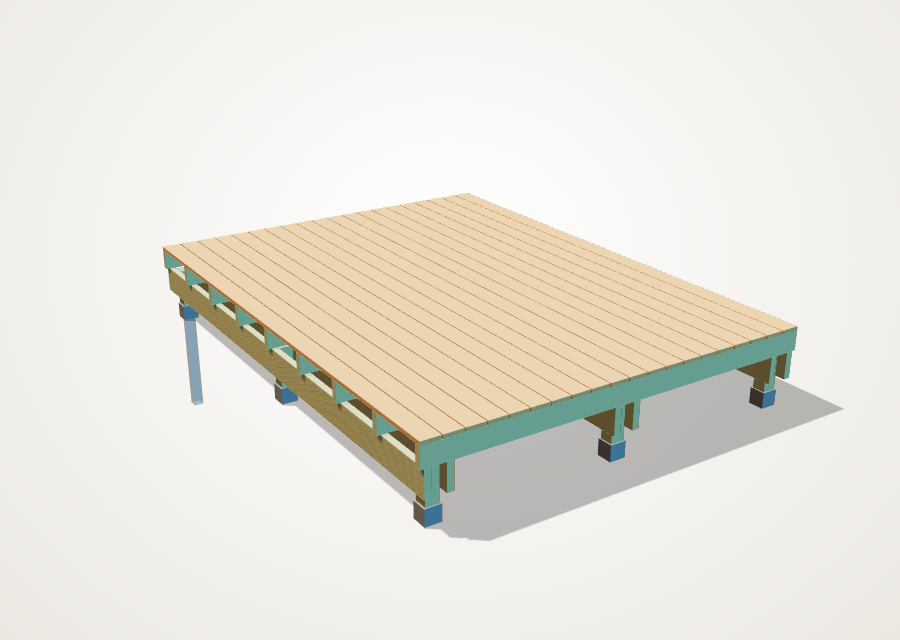
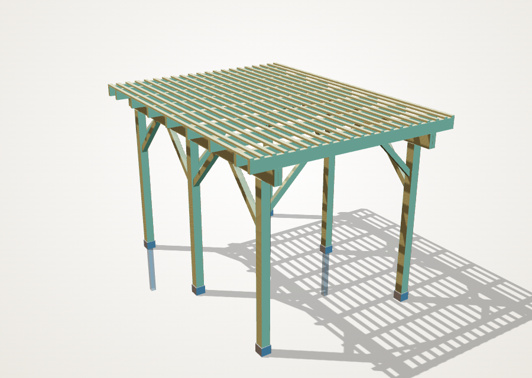
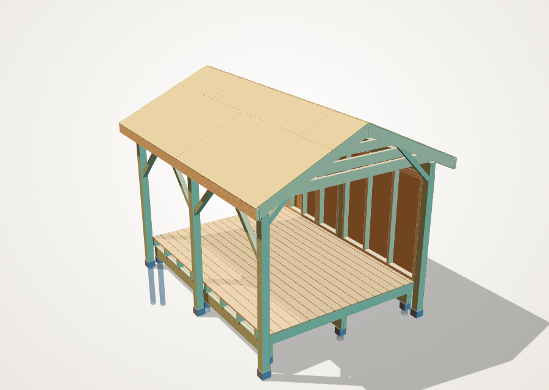
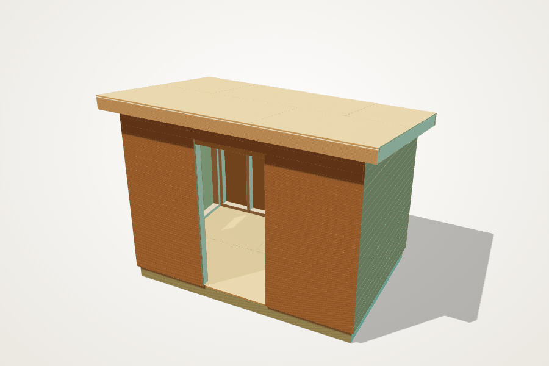
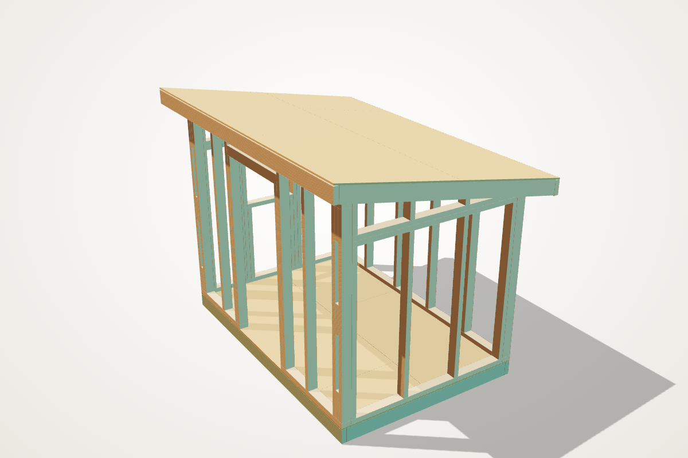

<div align="center">

# Chat to 3D Workbench

**Describe a thing. Look at it in 3D. Ask for the next version.<br>
Leave with the files to print it or the list to build it.**

[](https://github.com/aadaam1/chat-to-3d-workbench/actions/workflows/test.yml)
[](LICENSE)


|  |  |
|:---:|:---:|
| **A garden shed**: every stud, plate and rafter | **A tap aerator**: a printed part, in steel |

</div>

A workshop for designing real things by talking to Claude. You say what you
want; Claude asks what it needs to know, builds the model and opens it in an
interactive preview next to the chat. You turn it, cut it open, click where
something is wrong and say what. Each round is a new version. When it's
right, you get the print files, or the shopping list and cut list.

It's a place to **experiment with the chat-to-3D workflow**: no CAD program
to learn, nothing to host, and every design stays a plain file you own.

## The loop

```
  talk it through  ──▶  look and comment  ──▶  check it  ──▶  get the files
        ▲                       │
        └────── next version ◀──┘
```

1. **Talk it through.** What it does, what it has to fit, where it lives.
   If it must fit something, you measure that thing.
2. **Look and comment.** The preview shows the model. Click the part and
   write what should change, or just say it.
3. **Check it.** Wall thickness and overhangs for a print; spans, supports
   and framing conventions for a timber build.
4. **Get the files.** STL and STEP for printing, or a shopping list by
   stock length with the cuts from each piece.

|  |  |
|:---:|:---:|
| **Studio:** the part and the conversation | **Advanced:** sizes, checks and materials on a drawing sheet |

Claude does the thinking: which questions matter, what the trade-offs are.
**Scripts make every file**, so the same design always gives exactly the
same result.

## Two things it's good at

### Parts to print

Functional parts you can describe with dimensions: brackets, caps, clips,
spacers, adapters, mounts, enclosures, stands, hose and thread fittings.
Each part is a parametric [OpenSCAD](https://openscad.org) model, so "a bit
wider" is one number.

- **Checks before you print:** wall-thickness heatmap, overhangs, trapped
  hollows, and a rough price per material.
- **Print it anywhere:** the STL goes into any slicer for your own printer,
  or to a print service in resin, ASA, nylon, stainless steel or aluminium.
- **Edit it in CAD if you like:** every part also comes as a STEP file,
  which opens in Fusion and friends as a real solid, not a mesh.

Example: the [tap aerator](examples/tap-aerator/README.md), which turns a
garden tap's swirling jet into an even stream.

### Garden structures

Sheds, terraces, pergolas and summer kitchens. A short description (size,
heights, where the door and windows go, which sides are open) becomes a
frame of real timber: every footing, post, beam, joist, stud, rafter,
sheet and board.

|  |  |  |  |
|:---:|:---:|:---:|:---:|
| **Shed**, single-slope or gable roof | **Terrace** on ground screws, pier blocks or concrete | **Pergola**, open, braced both ways | **Summer kitchen**: a roof on posts, floor and walls optional |

|  |  |
|:---:|:---:|
| Peel the layers off in the preview | The frame, framed the way a carpenter frames it |

- **Checks:** joist, rafter, beam and header spans for the snow and floor
  load, sheet supports, treated timber near the ground, roof pitch, and
  framing conventions (king and jack studs, corners, lapped top plates,
  closed roof edges, every post on a footing, braces on open sides).
- **A shopping list and cut list** by stock length and sheet, nails by the
  kilo, priced from a dated timber-yard list.
- **Change one piece** ("move this stud", "leave this block out") and it
  stays changed through every rebuild.
- **Built from blocks:** foundations, posts, beams, a platform, walls and
  a roof put together by a recipe, so new shapes reuse the same rules and
  checks.
- European or US sizes.

Example: the [garden shed](examples/garden-shed/README.md), 3 × 2 m with a
door and a window.

## What it's not for

It speeds up designing and counting materials. It does **not** replace
design knowledge or structural engineering, and it can be wrong: check
everything before you build or print, and read the [disclaimer](DISCLAIMER.md).

- **Sculpted, organic shapes:** figurines, faces, jewelry, filigree. Use a
  sculpting tool.
- **Editing someone else's design.** It can check and preview an STL from
  elsewhere, but it designs its own models.
- **Structural engineering.** The timber checks are guidance, not an
  approval (see [Play safe](#play-safe)).
- **People new to building.** It assumes you can judge whether a design
  makes sense, or work with someone who can.
- **Replacing a CAD program.** This is for people who would rather
  describe a thing than learn one.

## Try it

You need the [Claude desktop app](https://claude.com/download) on a Mac,
with access to **Code**.

1. Open the Claude desktop app and switch to **Code**.
2. Pick a folder to work in, for example *Documents*.
3. Copy this prompt and send it:

```text
I'd like to try chat-to-3d-workbench, to design things to 3D print or build:
https://github.com/aadaam1/chat-to-3d-workbench

Please set it up for me. I don't use the terminal, so do every step yourself
and tell me in plain words what you're doing:
1. Clone the repository into this folder and open it.
2. Run tools/setup.sh. If it needs me to do something, walk me through it.
3. Run tools/selftest.sh and check it says READY.
4. Then ask me what I'd like to make.
```

Claude installs what's needed and checks that it works. On a Mac without
Homebrew it asks you to do one thing yourself: download the OpenSCAD app
and drag it into Applications. Linux works too; Windows isn't supported yet.

<details>
<summary><b>From a terminal</b></summary>

```bash
git clone https://github.com/aadaam1/chat-to-3d-workbench.git
```

```bash
cd chat-to-3d-workbench && tools/setup.sh && tools/selftest.sh
```

`setup.sh` installs OpenSCAD and the Python tools; `selftest.sh` builds a
throwaway part end to end and prints `READY`. Then start `claude` in the
folder and describe what you want:

> *I need a cap for the end of a 25 mm square steel tube on my garden fence,
> so rain stops getting in. It should push on and stay on.*

> *A 3 × 2.5 m garden shed with a sloping roof, a door at the front and a
> window on the left.*

> *A 4 × 3 m summer kitchen with a gable roof, open at the front, a wall
> at the back, on ground screws.*

</details>

## Your designs stay yours

Everything you make goes in `projects/<name>/`, which git ignores: it is
never committed or shared unless you choose to. The curated examples in
`examples/` are there to learn from.

```
.claude/skills/     how Claude works through a design
tools/              builds, checks, the preview, the timber generator (tools/timber/)
lib/, templates/    shared OpenSCAD library and a starting point for parts
data/timber/        timber sizes, fixings and dated price snapshots
examples/<name>/    curated examples (committed)
projects/<name>/    your own designs (ignored by git)
```

## Status

Version 0.7.1, a working prototype. macOS and Linux.
[Changelog](CHANGELOG.md) · [Roadmap](ROADMAP.md)

## Play safe

This is a tool for exploring designs faster, and you are responsible for
what you make and how you use it. The checks catch a lot, but they can't
promise a part will work, fit or hold up, or that a structure is safe.
"Looks good" means the workbench's own checks passed, nothing more.

- **Start with the cheapest print** and test it before ordering a better
  one.
- **Take extra care** with anything that holds pressure or weight, gets
  hot, or goes near food, drinking water, children or pets. Printed parts
  aren't certified for any of these.
- **Read the checks**, not just the picture.
- **Timber structures are guidance, not structural engineering.** The span
  and layout checks are simple formulas and rules of thumb compared with
  published tables, and the fixings are counted by rule of thumb. Check
  your local rules on size, distance to the boundary and permits, and have
  a qualified person look at anything people stand under, anything that
  carries snow, or anything that needs a permit.
- **Prices are a dated snapshot** of one supplier's public list, not an
  offer. Check them before you buy.

## Contributing

Pull requests are welcome: improvements to the tools, the checks, the
preview and the workflow. See [CONTRIBUTING.md](CONTRIBUTING.md).

## Licence

MIT, see [LICENSE](LICENSE). Provided as is, without warranty, and the
authors take no responsibility for any design or other output it produces:
see the [disclaimer](DISCLAIMER.md). The preview
page loads [three.js](https://threejs.org) (MIT) and fonts from Google
Fonts (Red Hat, Archivo and DM Mono, all OFL). Product names are trademarks
of their owners and are used only to say what a part fits.
