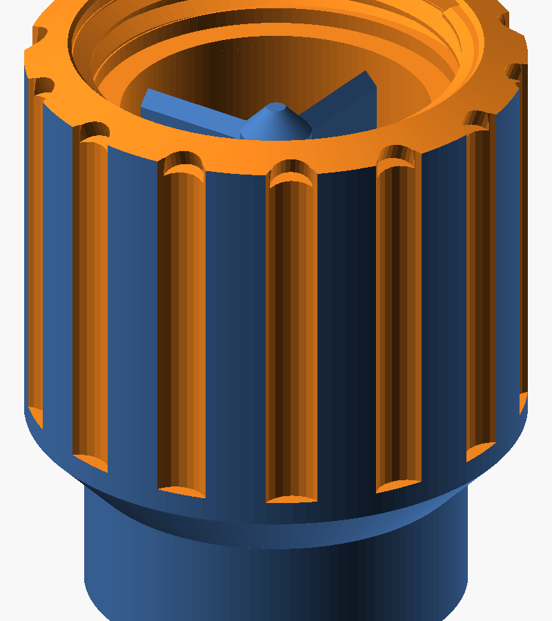
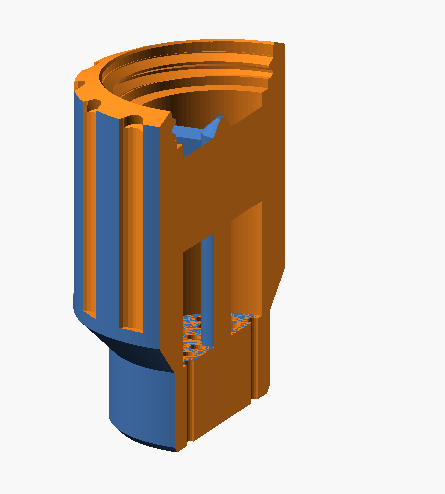

# Garden tap aerator

A 3D-printable flow conditioner that screws onto the **male BSPP outlet of a
garden tap** and turns the swirling, spiralling jet a ball-valve tap produces
into a uniform stream you can wash your hands or your vegetables under.

**One printed part. No assembly, no fasteners, no supports.**

Parametric OpenSCAD source, a build that produces the print files and a fluid
domain for CFD, and a hydraulic model so you can predict what a change does
before you print it.

> An example project in [chat-to-3d-workbench](../../README.md). Paths below are relative
> to this folder. Print files are not committed: run `./build.sh` and they
> appear in `out/`. For an interactive 3D preview, ask Claude for one (see the
> main README).

| | |
|---|---|
|  |  |
| The part | Cutaway — water flows top to bottom |

## Why your stream is bad right now

A ball valve is a hole in a sphere. Water leaves it as an off-axis jet carrying
a lot of **swirl** — tangential velocity — and a hose fitting downstream is just
a smooth tube, so the swirl survives all the way to the outlet. Swirl plus a
free surface is the whirlpool-shaped spray you're seeing.

The fix is not a smaller hole. It is removing the rotation, then re-organising
what's left into parallel streams.

## What's inside

Three zones, stacked, tap at the top:

| | Zone | What it does |
|---|---|---|
| 1 | **Settling chamber** | Ø26 mm. The tap bore opens into it and the jet loses most of its momentum straight away. |
| 2 | **Swirl breaker** | Four blades in a cross, 2.4 × 14 mm, ridged on top. Tangential velocity cannot survive a radial wall. This is the part that fixes your whirlpool. |
| 3 | **Exit straightener** | 36 parallel Ø2.0 mm channels on three rings (18 / 12 / 6), 12 mm long (length over diameter 6), opening straight out of the bottom face. Anything still rotating or crossing gets scrubbed out. |

Between the blades and the channels there is 17 mm of open Ø26 bore, so the
flow arrives at the channel field spread across all of it.

At 3 bar on an 18 L/min tap that's about **18 L/min — 98% of what the tap gives
with nothing on it — at 2.6 m/s** out of the channels. That's brisk at full
open; a quarter turn of the ball valve brings it down to a gentle hand-washing
stream. `flow.py` will redo those numbers for any change you make.

### Why there is no jet plate

The first design had a third hole layer, a plate of 24 × Ø1.4 jets between the
blades and the channels. It was a leftover from an early aerating version, and
the numbers never made much of a case for it: the channel bundle alone already
spreads the feed to within about 3% ([docs/DESIGN-NOTES.md](docs/DESIGN-NOTES.md)),
while the plate took 22% of the pressure drop and was the only bridge in the part.
The first print settled it — 1.4 mm holes are the first thing garden grit blocks.
It is gone. `JET_PLATE = true` still brings it back, but don't.

### Channels sized for the printer

The channel field has been through three versions:

| | Holes | Layout | Thinnest wall |
|---|---|---|---|
| v1 | 54 × Ø1.8 | hex grid, 2.7 mm pitch | 0.75 mm — under two extrusion lines, prints ragged |
| v2 | 24 × Ø2.4 | hex grid, 3.8 mm pitch | 1.25 mm — clean, but sparse, empty round the spine |
| **now** | **36 × Ø2.0** | **three rings, 18 / 12 / 6** | **1.14 mm** |

Rings follow the round bore instead of fighting it, which is how 36 holes fit
with printable walls everywhere, including the centre the hex grid left empty.
Each ring is phased by half its own spacing, so no hole lines up with one in
the next ring. Open area hardly matters for flow — the tap's own bore is about
ten times more restrictive than any of these fields.

### No weep holes

An earlier version drained the thread cavity — the pocket between the tap's male
thread and ours — through three holes in the wall, on the reasoning that the
gasket seals at the *bottom* of the thread so everything above it is atmospheric.

That reasoning only holds when the gasket is actually seated. Screw the part on
hand-tight but stop short of the gasket, which is the ordinary way to get it
wrong, and the thread cavity becomes part of the pressurised path — so the three
holes become three side jets at head height. A trapped film of rainwater is a far
smaller problem than a fitting that sprays when it isn't quite tight.

`WEEP_N` is still in the parameter block, set to 0, with the argument written out
next to it.

### The central spine

A Ø6 column runs from the top of the channel field up to where the swirl blades
cross, and is capped with a 45° cone so the incoming flow divides off it rather
than stagnating. It ties the blades to the channel field, so everything inside
the bore is one connected structure, and it costs 5% of the bore area.

### Why the top slopes

Screwed onto a downward-facing outlet, the top face is horizontal and a flat rim
there ponds rain against the tap's steel threads. The face slopes outwards
instead, and seven scallops cut through the rim so water leaves in whichever
direction the part happens to be turned.

### What it is not

**It does not aerate.** A true perlator mixes air into the water through side
ports to get that soft white kitchen-tap stream. That needs the mixing chamber
to sit near atmospheric pressure, and on a garden tap at 3 bar it doesn't — it
weeps water out of the air holes instead. This part makes the stream *uniform*,
not *white*. That was the actual complaint, so that's what it solves.

## Print this first

**Don't print the part yet.** Two things have to be right.

### 1. Check what thread your tap actually has

Caliper across the thread crests of the tap outlet:

| Measured OD | Thread | File |
|---|---|---|
| ~33.2 mm | G1" (BSPP) | `aerator_G1.stl` |
| ~26.4 mm | G3/4" (BSPP) | `aerator_G34.stl` |

Product listings get this wrong constantly — a "1 inch" garden tap very often
has G3/4" outlets. Measure the metal, not the plastic adapter on it.

### 2. Print a thread gauge

`out/stl/gauge_G1_0.30.stl` — about 10 minutes and 6 g. Screw it onto the tap.

- Binds or won't start → try `0.35`, then `0.40`
- Rattles, or won't pull a gasket up tight → try `0.25`, then `0.20`
- Goes on with light finger pressure and stops square → that's your number

Rim notches count the clearance: one per 0.05 mm above 0.15, so 3 notches =
0.30. Set `TAP_FIT` in `aerator.scad` and re-run `build.sh`.

## Then print

One part, plus one flat rubber washer — a standard 1" hose-fitting gasket
(≈30 × 23 × 2 mm), or cut one from 2 mm EPDM. A G thread is parallel and seals
on nothing by itself; the washer does all of it.

**Measure your tap's male thread length too**, from its end face to where the
thread stops. `TAP_THREAD_LEN` (5 mm by default) must be **shorter** than that,
or the spigot's end stops short of the gasket, nothing gets compressed, and it
drips however hard you tighten — but only by about 0.5 mm. Any more and the
part's top stands proud of the tap's thread as a ring-shaped cup that holds
water. The first print used 11 mm and did exactly that: this tap has only about
2.5 turns (~5.5–6 mm). Many others carry 12–14 mm — measure yours.

**In metal:** `aerator_G1_metal` and `aerator_G1_metal_compact` are thin-walled
versions for SLM 316L printing (JLC3DP and the like) — see
[docs/METAL.md](docs/METAL.md) for what changes and why aluminium and binder
jetting are the wrong choices.

`aerator_G1_compact.stl` is the same part 9 mm shorter (less open bore under
the blades, channels at L/D 5). The standard one is proven to give an even
stream; print the compact one next to it and keep it if the stream is as good.

### How much flow can you actually have?

**Your tap's free flow is the ceiling, and nothing screwed onto it can beat it.**
Measure it first: bucket, stopwatch, thirty seconds, nothing attached. Without
the jet plate the part gets within 2–3% of it:

| Tap, wide open | Through the aerator | 10 L can |
|---|---|---|
| 15 L/min | 14.9 | 40 s |
| 18 L/min | 17.8 | 34 s |
| 22 L/min | 21.7 | 28 s |
| 26 L/min | 25.4 | 24 s |

**20 L/min needs a tap that free-flows about 20.** Hand washing needs a quarter
of that; sizing for the fast job and throttling down with the ball valve is
easy, the other way round is impossible.

`flow.py` runs this model: put your own tap measurement in (see
[Tuning it](#tuning-it)).

**Material: ASA.** UV-stable, holds up outdoors for years. PETG is an easy
second and seals well, but chalks after a couple of summers in the sun. Not PLA
— it creeps under pressure and dies in UV.

**Orientation: outlet face flat on the bed, threaded end up. No supports.** The
internal geometry is laid out so every bore steps outward going up; with the jet
plate gone there is no bridge anywhere in the part. The bottom edge has a 1 mm
45° chamfer for the squashed first layer. Full settings in
[docs/PRINTING.md](docs/PRINTING.md).

## Tuning it

```
python3 flow.py --help
python3 flow.py --tap-free 18     # measure yours: bucket, stopwatch, 30 s
```

Measure your tap's free flow first, with nothing attached. Everything else the
model says is meaningless without it, because on a garden tap the **supply
pipe**, not the aerator, is usually the main restriction. One consequence: past
a point, bigger channels buy almost no extra flow.

All the geometry comes from the parameter block at the top of
`aerator.scad`. Change a number, run `build.sh`, print.

## Simulating it

`out/stl/fluid_domain.stl` is the **water volume**, not the part — the negative
space, with inlet and outlet extensions, which is what a CFD solver wants. It's
carved out of the real geometry, so it can't disagree with the part.

[docs/CFD.md](docs/CFD.md) covers what's worth simulating and what isn't.
[docs/SIMFLOW.md](docs/SIMFLOW.md) is a concrete walkthrough, including the
swirling inlet condition that actually reproduces the problem — a clean axial
inlet tests nothing.

## Handing it to someone else to print

`./build.sh` also assembles `out/handover/`, a self-contained folder for whoever
owns the printer: the gauges to print first, the part, and `PRINT-ME.txt` with
the material, the orientation, the five settings that matter and how to tell it
came out right. Zip it as `tap-aerator-prints-v<N>.zip` and send it.
`PRINT-ME.txt` names the files exactly, so change it and `build.sh` together.

For editing in Fusion, Onshape, FreeCAD or any other CAD package, `out/step/`
has every final part as a **STEP** solid — real cylinders, planes and cones, not
a triangle mesh, so faces can be pushed, holes resized and edges chamfered.
Those files are generated from the `.scad` sources by the workshop's
`tools/scad2step.py`; the `.scad` stays the master. The only faceted feature is
the aerator's thread.

## This folder

```
aerator.scad     the design. Parameters at the top, geometry below.
build.sh         builds every STL, STEP, render and the handover folder
flow.py          1D hydraulic model
PRINT-ME.txt     the sheet that goes into out/handover/
docs/            fitting, printing, metal, CFD, SimFlow, design notes
img/             renders used on this page (committed; build.sh refreshes them)
out/             build output, not committed:
  stl/             ready to print
  step/            the same parts as editable CAD solids
  handover/        the folder to hand to whoever owns the printer
```

Shared with other projects, at the repo root: `lib/threads.scad` (helical BSPP
G1", G3/4", G1/2"), `lib/process.scad`, and `tools/` (`thinwall.py` wall-thickness
check, `partcheck.py`, `scad2step.py`, `make_viewer.py`).

Requires OpenSCAD 2021.01 or newer. `./build.sh fast` for a quick look.
STEP export additionally needs `pip install cadquery-ocp`; without it the build
skips that step. `tools/setup.sh` at the repo root installs the lot.

## Caveats

- Printed plastic on a pressurised water line. Walls are ≈4 mm against about
  3 MPa of hoop stress at 10 bar, so the margin is large, but print it solid
  enough — see the printing notes.
- FDM parts are not certified for potable water. Fine for hands and vegetables
  on a garden tap; layer lines do harbour biofilm, so unscrew it and soak it in
  vinegar now and then.
- The channels are Ø2.0 mm. Grit will eventually find them. Unscrew and
  back-flush; a 2.0 mm drill bit turned by hand clears any that stay blocked.
- **One aerator has been printed (the first version, with the jet plate); nothing
  has been wet-tested yet.** The geometry is verified watertight and the
  hydraulics are hand-calculated. The flow figures are predictions.

## Aerator, perlator, or neither?

**Perlator is a brand.** It's Neoperl's trademark, which went generic in German
and Hungarian the way Hoover did for vacuum cleaners in English. A Perlator and
an aerator are the same object; there is no technical distinction between the
two words.

The distinction that *is* real is between **aerated** and **non-aerated**:

- An **aerated** outlet draws air in through side ports and mixes it into the
  water. You get the soft white stream of a kitchen tap, less splash, and less
  water for the same apparent volume. It needs the mixing chamber to sit at or
  below atmospheric pressure to pull the air in.
- A **non-aerated** one — sold as a *laminar* or *flow-straightener* outlet —
  just conditions the water. Clear stream, no bubbles.

**This is the second kind**, so "aerator" is loose for what it does, and the
name is a holdover. It doesn't aerate because at garden pressure the
chamber won't sit below atmospheric: the air ports would push water out sideways
instead of drawing air in. That was tried in v1 and abandoned.

## History

The first version was three parts — a threaded body, two interchangeable caps
and a drop-in straightener — with side air ports for true aeration. It was
wrong in three ways, all caught on review of the render: the male thread was
unioned with a cylinder at its own crest diameter and so did not exist; the
straightener was sealed inside a pocket narrower than itself at both ends; and
seven of fifteen jets sat directly under a swirl blade. It was also more part
than the job needs. This version does the same hydraulic work in one piece.

## Licence

MIT — see [LICENSE](../../LICENSE).
